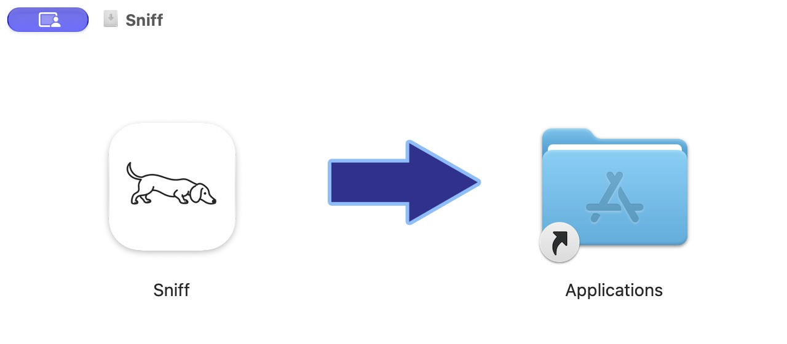

# Sniff

A native macOS app for cleaning up after AI-assisted development. Licensed under [MIT](LICENSE).

Sniff was built to automate the routine cleanup that comes with working with AI coding agents. Repeated package installs, temporary runtimes and build output can leave a lot behind. Keeping track of it all shouldn't become another job for you or your agent harness.

Sniff handles that work locally, using explicit cleanup rules. It makes no model calls, needs no API key and consumes no AI tokens. You can review a cleanup yourself or schedule maintenance for the caches you choose, while keeping your projects and agent sessions intact.

[Install](#install) · [Usage](#usage) · [Scheduling](#scheduling) · [CLI](#command-line) · [Technical details](#technical-details)


*Example scan with sample data. Sizes are estimates; measured changes in free space appear separately in History.*

## What it covers

Sniff recognizes specific cache and temporary-file locations. These can be used by agents or by you directly; it doesn't try to guess which process originally created a file.

| Area | What Sniff handles |
| --- | --- |
| Package and build caches | npm, pnpm, uv, Bun, pip, node-gyp, Go, TypeScript, SwiftPM, Homebrew, NuGet, Cargo and Gradle caches. Supported categories can be scheduled. |
| Agent leftovers | Old Codex runtime installation folders, recognized updater caches and selected log directories. Logs require manual review. |
| Additional manual cleanup | Old npx environments, Rust `target` and Swift `.build` folders in project roots you choose, and the recognized Claude VM image. MCP environments in npx are preserved. |
| Git worktrees | Finds registered worktrees and checks visible usage, local changes, ignored files and pending commits. Old, clean copies with published and integrated commits can be selected for manual cleanup. |
| Inspection only | Docker/OrbStack storage and macOS code signing copies. Sniff reports these without deleting them. |

Primary checkouts, branches, agent sessions, settings, credentials, databases, container volumes and the main runtime are preserved. Worktree cleanup removes a redundant working copy only after the Git and local-state checks pass. The [cleanup policy](docs/cleaning-policy.md) lists the recognized paths, retention rules and exceptions.

## Install

Download the latest [prerelease](https://github.com/JohnRenatoDev/sniff-cleaner/releases). Open the DMG and drag **Sniff** to **Applications**. Eject the disk image, then open Sniff from Applications.



Requires macOS 14 or later. Downloads include Apple Silicon and Intel binaries; runtime testing has been on Apple Silicon. The CLI is optional and has [separate setup instructions](docs/cli.md).

The current preview is ad hoc signed and has not been notarized by Apple, so macOS may block it. Read the [installation notes](docs/INSTALL.txt) before opening it.

## Usage

1. Run a scan. Scanning does not remove files.
2. Check each item's path, size and status. Sniff explains why an item is being kept.
3. Select what you want to remove and choose **Review cleanup**.
4. Review the full paths and confirm permanent removal. Sniff checks the files and visible process usage again before deleting them.

Items start unchecked. In Settings, choose project folders, set retention periods and exclude paths you want to keep. Excluding a path inside a cleanup candidate preserves the whole candidate folder.

To focus on worktrees, open **Projects and worktrees** and choose **Scan worktrees**. Filter candidates, pending work or active copies. Worktrees must be outside the retention period (14 days by default). Commit checks use locally recorded remote references; Sniff does not fetch or contact the server. If it cannot verify a worktree, it keeps it.

The app and CLI support English, Portuguese and Spanish. Choose a language in Settings → General → Language. App text changes immediately; some macOS menu actions need an app restart. The interface follows the system appearance and respects Reduce Motion.

## Scheduling

Scheduling is off by default. You can enable scheduled scans to review later, or allow automatic cleanup of selected caches that tools can recreate. Automatic cleanup excludes worktrees, npx environments, project builds, logs, VMs and all inspection-only categories.

The scheduler uses a macOS user LaunchAgent with low-priority disk I/O. It wakes every 15 minutes to check whether a run is due, then exits. If it detects a supported build in progress or cannot complete its process checks, it postpones the run for an hour. Scheduled scans cover known caches; project discovery and worktree/container inspection happen during manual scans. An optional monitor checks root-directory metadata every six hours without walking their contents.

These choices are intended to keep routine maintenance out of your development work. Scans still use CPU and disk I/O, and clearing caches can make the next install or build slower while tools download or regenerate files. Choose categories and retention periods around your workflow.

The Mac must be awake and you must be logged in. Runs may be delayed during sleep or logout. If you move Sniff after registering the service, turn scheduling off and on again from its new location.

## How cleanup is checked

Each scan records a manifest of file identities and metadata. Cleanup plans expire 15 minutes after the scan. Before deletion, Sniff rechecks category permissions, exclusions, retention, the manifest and visible process usage. Changed files and inconclusive checks cause an item to be kept.

Removal uses directory descriptors with `openat(O_NOFOLLOW)`, `fstatat` and `unlinkat`. It refuses symlink ancestors and volume boundaries, removes internal symlinks as links, and deletes only entries in the reviewed manifest. A shared `flock` prevents the app, CLI and scheduler from running overlapping operations. Sniff doesn't terminate agents, applications or builds to make a file removable, and it doesn't require root or sudo.

Process checks have limits: another program can start using a file after a check. Deletion is permanent, and a failure partway through can leave a partially cleaned item. History records those outcomes. APFS snapshots and shared blocks also mean estimated file allocation may differ from the measured change in free disk space.

## Command line

```sh
sniff scan --quick
sniff plan --category npm --output ./cleanup-plan.json
sniff clean --plan ./cleanup-plan.json
```

`clean` requires a saved plan and asks you to confirm deletion. The app and CLI share the same scanner, cleanup checks, settings and history. JSON output is available for scripts. Saved plans contain local paths and file metadata, so keep them private.

The [CLI reference](docs/cli.md) covers installation, commands, noninteractive approval and exit codes. Use the app to register or disable the macOS background service.

For a worktree-only scan, use `sniff scan --worktrees`, then `sniff list --category worktree` to review the results.

## Technical details

Sniff is written in Swift with SwiftUI and AppKit, built with Swift Package Manager, and has no third-party runtime dependencies.

| Component | Responsibility |
| --- | --- |
| `Sniff` | Desktop app, Settings and menu bar integration. Scanning and cleanup run off the UI thread at utility priority. |
| `SniffCore` | Rule catalog, process inventory, scanning, cleanup policies, file removal, persistence and scheduling logic. |
| `SniffCommands` / `SniffCLI` | Command parsing, plan export and terminal access to the same core. The packaged command is `sniff`. |
| Background service | `SMAppService` registers a user LaunchAgent that runs Sniff with `--scheduled`. Each invocation runs once and exits. |

State stays in `~/Library/Application Support/Sniff/state.json`, with an owner-only directory and file permissions. It stores preferences, the latest scan and up to 30 cleanup results. The inventory records paths and file metadata; it does not copy file contents, credentials or session text. Build products and local scan results are excluded from Git.

See the [architecture](docs/architecture.md) for process boundaries, scan limits, persistence and scheduling details.

## Build and test

Requires macOS 14 or later and a Swift 6.2 or newer toolchain.

```sh
./script/build_and_run.sh
```

The script builds the Swift package, packages a locally signed app and opens it.

```sh
./script/test.sh
./script/test_scheduler.sh
```

Removal tests use isolated temporary fixtures. The scheduler test creates a temporary LaunchAgent, verifies that macOS starts it and removes the job afterward. It does not clean user data.

Build universal release files with `./script/build_release.sh`. The [release instructions](docs/releases.md) cover DMG and CLI packaging, artifact validation, Developer ID signing and notarization.

## License

Sniff is licensed under the [MIT License](LICENSE).

🇧🇷 #BrazilianEngineer
