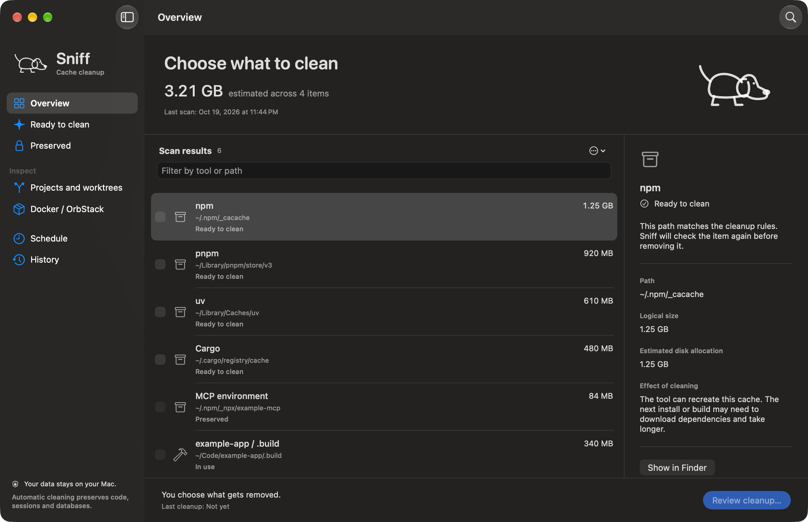
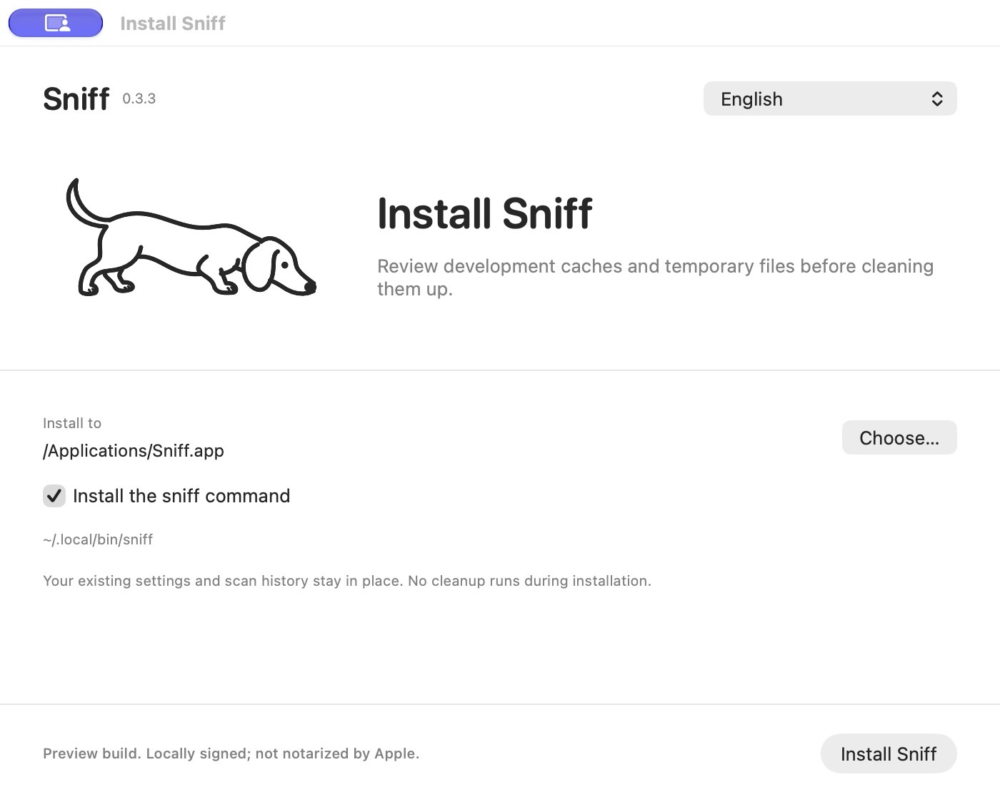
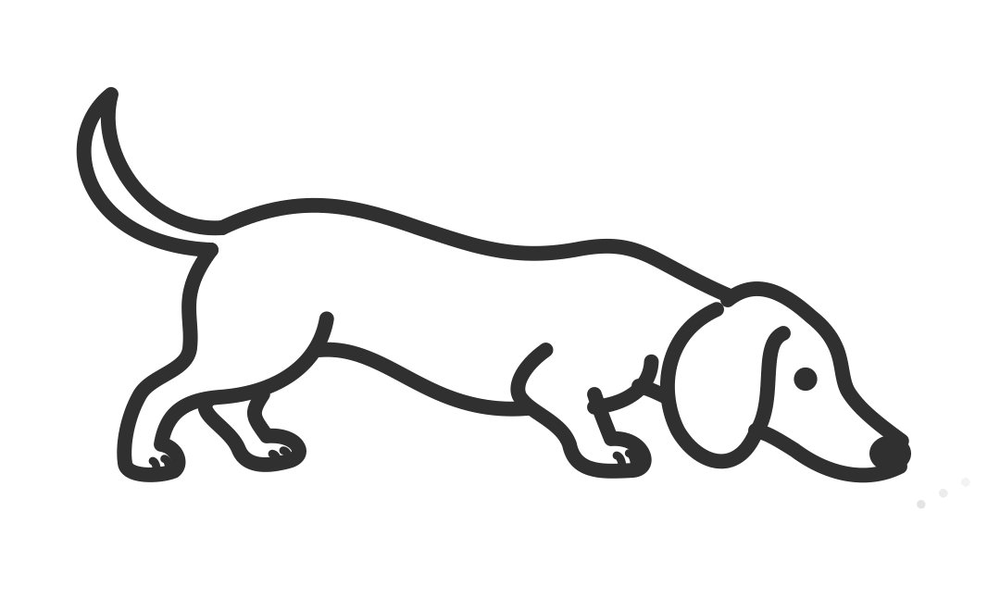

# Sniff Cleaner

Sniff finds development caches and temporary files on your Mac. Review each path, choose what to delete and confirm the cleanup. The app checks the files again before removing them.



*Example scan with sample data. The sizes shown are estimates, not a promise of space recovered.*

## Install the preview

Download the latest private [prerelease](https://github.com/JohnRenatoDev/sniff-cleaner/releases). Open the DMG, run **Install Sniff.app** and choose where to install it. You can also install the `sniff` command. Your settings and scan history stay in place; installation does not run a cleanup.

Requires macOS 14 or later. The downloads include Apple Silicon and Intel binaries. Runtime testing has been on Apple Silicon.

This preview has a local ad hoc signature and has not been notarized by Apple. macOS may block the download. See the [installation notes](docs/INSTALL.txt) before opening it.



## Review before cleaning

1. Scan the Mac. Scanning does not remove files.
2. Check each item's path, status and reason for preservation.
3. Select the items you want to remove and choose **Review cleanup**.
4. Review the full paths and confirm permanent removal. Sniff rechecks the files and process usage before removing them.

Items start unchecked. In Settings, you can choose project folders, exclude paths and set retention periods. An exclusion inside a folder keeps the whole folder.

Automatic cleanup is off by default. If you enable it, Sniff cleans only enabled categories of caches that tools can recreate. Worktrees, Docker and code signing copies are available for inspection only. By default, Sniff keeps source code, sessions, credentials, databases, container volumes and the main runtime.

File allocation is an estimate. History shows the measured change in free disk space separately, because APFS snapshots, hardlinks and other applications can affect the result.

## Command line

```sh
sniff scan --quick
sniff plan --category npm --output ./cleanup-plan.json
sniff clean --plan ./cleanup-plan.json
```

`clean` requires a saved plan and asks you to confirm deletion. The CLI also supports JSON output for automation. The [CLI reference](docs/cli.md) covers installation, commands, cleanup checks and exit codes.

## Languages and mascot

The app, CLI and installer support English, Portuguese and Spanish. Choose a language in Settings → General → Language. App text changes immediately; some macOS menu actions need an app restart.

Sniff's mascot is a hand-drawn dachshund. It follows a scent with short sniffs, pauses for a curious glance, then wags its tail in little bursts. Its hips and loose ear follow the movement.

The dog animates during scans and cleanup and stays still when idle. The installer shares the same artwork. Reduce Motion keeps the dog still.



## Build and run

Requires macOS 14 or later and a Swift 6.2 or newer toolchain.

```sh
./script/build_and_run.sh
```

The script builds the Swift package, packages a locally signed app and opens it. Build products and local scan results are excluded from Git.

## Tests and release builds

```sh
./script/test.sh
./script/test_scheduler.sh
```

Removal tests use temporary fixtures. The scheduler test creates a temporary LaunchAgent, checks that macOS starts it and removes the job afterward. It does not clean user data.

Build universal release files with `./script/build_release.sh`. See the [release and signing instructions](docs/releases.md) for packaging, Developer ID signing and notarization. These are required before offering a trusted public macOS download.

See [architecture](docs/architecture.md) and [cleanup policy](docs/cleaning-policy.md) for the implementation and its limits.
